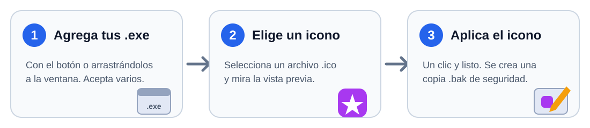

<p align="center">
  
</p>

<p align="center">
  
  
  
  
</p>

<p align="center">
  <b>Una app pequeña, rápida y sin instalación para cambiar el icono de uno o varios <code>.exe</code>.</b><br>
  Arrastra, elige el icono y listo.
</p>

---

## ✨ ¿Qué es?

**CambiarIcono** es una aplicación de escritorio para Windows, escrita en C++ con la API de Windows (Win32), que reemplaza el icono de cualquier archivo `.exe` por el que tú elijas.

No necesita instalar nada, no usa librerías externas y el ejecutable resultante es un solo archivo.

## 🚀 Características

- 🖱️ **Arrastrar y soltar**: suelta tus `.exe` directamente sobre la ventana.
- 📦 **Varios archivos a la vez**: aplica el mismo icono a toda una lista.
- 🖼️ **Vista previa** del icono antes de aplicarlo.
- 🛡️ **Copia de seguridad automática** (`archivo.exe.bak`), que puedes desactivar.
- 📋 **Registro de resultados**: sabes cuál archivo se cambió y cuál falló, y por qué.
- 🪶 **Ligera y portable**: un solo `.exe`, sin instalador ni dependencias.
- 🔇 **Sin ventana de consola** de fondo.

## 🧭 Cómo se usa

<p align="center">
  
</p>

1. Abre `CambiarIcono.exe`.
2. Agrega uno o varios `.exe` con **Agregar...** o arrastrándolos a la ventana.
3. Pulsa **Examinar...** y elige un archivo `.ico`.
4. Pulsa **Aplicar icono**.

> [!TIP]
> Si no ves el cambio de inmediato, es la caché de iconos de Windows. Reinicia el Explorador de archivos o ejecuta `ie4uinit.exe -show` desde el menú Inicio o una consola.

<!-- Cuando tengas una captura de pantalla, súbela a assets/ y descomenta esta línea:
<p align="center"></p>
-->

## 🛠️ Compilar

Solo necesitas un compilador de C++ para Windows. El código es C++ clásico (sin C++11) y no requiere enlazar librerías adicionales.

| Compilador | Pasos |
|---|---|
| **Visual Studio** | Crea un **proyecto vacío** de C++, agrega `CambiarIcono.cpp` y `CambiarIcono.rc`, y compila. El subsistema Windows ya se fuerza desde el código. |
| **MinGW (consola)** | `windres CambiarIcono.rc -O coff -o icono.o`<br>`g++ CambiarIcono.cpp icono.o -o CambiarIcono.exe -mwindows -static` |
| **Dev-C++ / Code::Blocks** | Crea un proyecto *Windows Application*, agrega `CambiarIcono.cpp` y `CambiarIcono.rc`, y compila. |

> [!NOTE]
> El archivo `CambiarIcono.rc` es el que pone el icono al propio `.exe` (el que ves en el Explorador). El icono de la ventana ya va incrustado en el código, así que se ve aunque compiles sin el `.rc`.

## ⚙️ ¿Cómo funciona por dentro?

Un `.exe` guarda sus iconos como *recursos* (`RT_ICON` y `RT_GROUP_ICON`). La app:

1. Abre el `.exe` como datos y localiza su grupo de iconos actual.
2. Lee tu archivo `.ico` y separa cada una de sus imágenes (distintos tamaños).
3. Con `BeginUpdateResource` / `UpdateResource` / `EndUpdateResource` elimina los iconos viejos, escribe los nuevos y actualiza el grupo.

Todo se hace con la API estándar de Windows, sin tocar nada más del programa.

## ⚠️ Limitaciones y preguntas frecuentes

<details>
<summary><b>¿Qué formatos de icono acepta?</b></summary>

Solo archivos `.ico`. Para mejores resultados usa uno que incluya varios tamaños (16, 32, 48 y 256 px).
</details>

<details>
<summary><b>¿Funciona con programas firmados digitalmente?</b></summary>

El icono se cambia, pero al modificar el archivo **la firma digital deja de ser válida**.
</details>

<details>
<summary><b>¿Y con programas protegidos o empaquetados (UPX, Themida, etc.)?</b></summary>

Pueden fallar o dejar de abrir después del cambio. Por eso la copia de seguridad `.bak` viene activada por defecto.
</details>

<details>
<summary><b>Me sale un error al aplicar el icono</b></summary>

- Cierra el programa si está en ejecución: un `.exe` abierto no se puede modificar.
- Si está en una carpeta protegida (por ejemplo `Program Files`), ejecuta CambiarIcono como administrador.
- Algunos antivirus pueden advertir al ver que se modifica un ejecutable. Es esperable porque la app cambia el archivo.
</details>

<details>
<summary><b>¿Qué versión de Windows necesito?</b></summary>

Windows Vista o superior. Se recomienda Windows 10 u 11.
</details>

## 📁 Estructura del repositorio

```text
CambiarIcono/
├─ CambiarIcono.cpp     # Código fuente de la aplicación
├─ CambiarIcono.rc      # Recurso que pone el icono al propio .exe
├─ icono.ico            # Icono de la aplicación
├─ README.md
└─ assets/
   ├─ banner.svg        # Cabecera del README
   ├─ logo.svg          # Logo en vector
   └─ como-funciona.svg # Diagrama de uso
```

## 📄 Licencia

Distribuido bajo la licencia **MIT**. Agrega un archivo `LICENSE` con el texto de la licencia y tu nombre.
